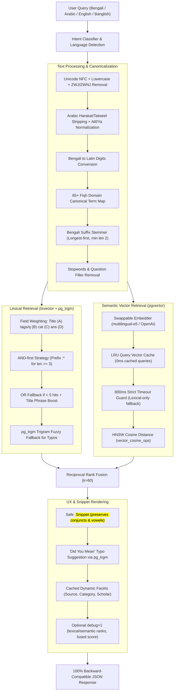

# Fatwa & Islamic Q&A Search Platform (Monorepo)

A high-performance, minimalist search engine aggregating and indexing authentic Islamic Q&As and Fatwas from **Al-I'tisam**, **At-Tahreek**, and **Al-Kawsar**.

Organized as an enterprise **Turborepo** monorepo supporting web, mobile (Expo), and shared TypeScript packages.

---

## 🏗️ Monorepo Architecture

```
.
├── apps/
│   ├── web/                  # Next.js 14 App Router web platform
│   └── mobile/               # Expo (React Native) mobile application
├── packages/
│   ├── api-client/           # Typed client generated from OpenAPI 3.1 & Zod schemas
│   ├── text-utils/           # Pure TS Bengali normalizer, stemmer & synonym registry
│   └── config/               # Shared tsconfig & ESLint presets
├── docs/
│   ├── openapi.yaml          # OpenAPI 3.1 REST API specification
│   └── ...
├── data/
│   └── fatwas.db             # SQLite search database (WAL mode)
├── scraper/                  # Python incremental scrapers & sync scripts
├── turbo.json                # Turborepo task pipeline configuration
└── package.json              # Monorepo root workspace configuration
```

---

## 📦 Workspaces & Packages

### Applications (`apps/`)

- **`apps/web`**: Production Next.js 14 (App Router) web application featuring full-text search, semantic search, Banglish transliteration, dynamic facets, AI-powered RAG, dark mode, and an admin dashboard.
- **`apps/mobile`**: Cross-platform Expo / React Native mobile application integrating `@repo/api-client` and `@repo/text-utils` for online and offline search capabilities.

### Shared Packages (`packages/`)

- **`@repo/api-client` (`packages/api-client`)**: Fully typed, production API client with runtime validation powered by Zod schemas mirroring `docs/openapi.yaml`. Exports client class, types, and schemas for web and mobile consumers.
- **`@repo/text-utils` (`packages/text-utils`)**: Pure TypeScript utilities with zero external dependencies, providing:
  - Bengali Unicode orthographic normalizer (`normalizeBengaliText`)
  - Bengali morphological suffix stemmer (`stemBengaliToken`)
  - Stopword detection (`isStopWord`)
  - Fiqh synonym and orthographic variant expansion (`getSynonymsAndVariants`, `isAblutionTerm`)
- **`@repo/config` (`packages/config`)**: Shared presets for TypeScript (`tsconfig/base`, `tsconfig/nextjs`, `tsconfig/react-library`, `tsconfig/react-native`) and ESLint.

---

## 🚀 Quick Start

### 1. Prerequisites
- Node.js >= 20.0.0 < 23.0.0
- npm >= 10.0.0 (or pnpm)

### 2. Install Dependencies

Install all dependencies across all workspaces:

```bash
npm install
```

### 3. Environment Setup

Create `.env.local` inside `apps/web/`:

```bash
cp apps/web/.env.example apps/web/.env.local
```

| Variable | Description | Default |
| :--- | :--- | :--- |
| `INGESTION_SECRET_TOKEN` | Bearer token required for `/api/v1/ingest` | `super_secure_fatwa_ingest_token_change_me_in_prod` |
| `DATABASE_PATH` | Path to SQLite database file | `../../data/fatwas.db` |
| `NEXT_PUBLIC_APP_URL` | Base application URL | `http://localhost:3000` |

---

## 💻 Common Commands (Turborepo)

Turborepo orchestrates builds, linting, tests, and development across the monorepo:

### Development
```bash
# Start all workspaces in parallel
npm run dev

# Or start specific applications
npm run web:dev        # Start Next.js web application
npm run mobile:dev     # Start Expo mobile app
```

### Type Checking & Linting
```bash
# Type check all workspaces
npm run type-check

# Lint all workspaces
npm run lint
```

### Testing
```bash
# Run tests across packages
npm test

# Run web app tests specifically
npm run web:test
```

### Production Build
```bash
# Build all apps and packages with Turbo caching
npm run build
```

---

## 🌐 Deployments (Vercel)

For web deployment on Vercel:

1. **Framework Preset**: `Next.js`
2. **Root Directory**: `apps/web`
3. **Build Command**: `next build` (or `npx turbo run build --filter=@repo/web`)
4. **Output Directory**: `.next` (default)
5. **Install Command**: Vercel automatically detects the Turborepo root and runs `npm install` across workspaces.

> [!NOTE]
> Database bundling: `apps/web/next.config.mjs` configures `outputFileTracingIncludes` to bundle the SQLite database into serverless functions.

---

## 🔍 Search Architecture & Intent-Aware Hybrid Retrieval

The search engine features an intent-aware hybrid retrieval pipeline combining **PostgreSQL `tsvector` lexical retrieval**, **`pg_trgm` typo tolerance**, **`pgvector` HNSW semantic embeddings**, and **Reciprocal Rank Fusion (RRF)**.



### 1. Unified Text Pipeline (`packages/text-utils`)
Documents at ingest time and queries at search time pass through the exact same deterministic pipeline:
- **Unicode Normalization**: NFC decomposition, lowercase conversion, and removal of zero-width joiners/non-joiners (`\u200C`, `\u200D`).
- **Arabic Diacritic & Script Normalization**: Harakat/tashkeel stripping (`\u064B-\u065F`, `\u0670`), tatweel stripping (`\u0640`), Alif forms unification (`أإآٱ -> ا`), Alif Maqsura to Ya (`ى -> ي`), and Arabic definite article (`ال-`) resolution.
- **Digit Normalization**: Bengali numerals (`০-৯`) converted to Latin digits (`0-9`).
- **Fiqh Synonym Registry (`packages/text-utils/src/synonyms.ts`)**: 65+ distinct fiqh domain synonym clusters canonicalizing orthographic variants and cross-lingual terms across Bengali, Arabic, English, and Banglish (e.g. `সালাত` $\leftrightarrow$ `ছালাত`, `নামাজ`, `নামায`, `salat`, `salah`, `namaz`, `صلاة`).
- **Light Bengali Stemmer**: Strips inflectional case markers, articles, and plural suffixes (`গুলোতে`, `গুলোর`, `দের`, `ের`, `টি`, `তে`, `রা`...) longest-suffix first, preserving root words with length $\ge 2$.
- **Stopwords Removal**: Removes conversational interrogatives (`কি`, `কী`, `কেন`, `কিভাবে`), auxiliaries (`হবে`, `হয়`, `আছে`), and domain fillers (`বিধান`, `হুকুম`, `সম্পর্কে`, `ruling`, `about`) from lexical ranking.

### 2. PostgreSQL Lexical Search (`apps/web/src/lib/search/postgres.ts`)
- **Weighted tsvector**: Weighted as Title (`A`, 1.0), Question & Tags (`B`, 0.4), Category (`C`, 0.2), and Answer (`D`, 0.1).
- **Multi-stage Strategy**: Evaluates boolean `AND` query first with prefix matching (`:*`) for tokens with length $\ge 3$. If fewer than 5 results are returned, executes an expanded `OR` query, followed by a `pg_trgm` fuzzy similarity search for typo tolerance.
- **Exact Phrase Bonus**: Grants a +3.0 score boost when the normalized query text appears as a contiguous substring in the fatwa title.

### 3. Semantic Vector Search (`apps/web/src/lib/search/embedder.ts`)
- **Model Support**: Swappable embedder supporting local ONNX multilingual models (`Xenova/multilingual-e5-small`, `bge-m3`) with zero API costs, or OpenAI API (`text-embedding-3-small`) via environment variables.
- **HNSW Index**: 1536-dimensional vectors indexed via Hierarchical Navigable Small World (`hnsw (embedding vector_cosine_ops)` with $m=16, ef\_construction=64$).
- **Zero Latency Query Cache**: LRU in-memory query vector cache delivering 0ms response times for repeated searches.
- **Graceful Degradation**: 800ms strict timeout guard. If vector inference times out or fails, search seamlessly falls back to lexical retrieval without returning errors to the user.

### 4. Reciprocal Rank Fusion (`apps/web/src/lib/search/rrf.ts`)
Fuses the top 50 lexical candidates and top 50 semantic vector candidates using Reciprocal Rank Fusion:
$$RRF\_score(d) = \sum_{m \in \{\text{lexical}, \text{semantic}\}} \frac{w_m}{k + rank_m(d)}$$
with smoothing constant $k = 60$ and default weights $w_{lex}=1.0, w_{sem}=1.0$.

### 5. Evaluation Benchmark (`eval/golden.json`)
The evaluation harness (`scripts/eval-search.ts`, `npm run eval:search`) benchmarks retrieval quality on 46 real-world test queries across Bengali, Banglish, Arabic, English, misspellings, and natural language questions:

| Metric | Baseline (MiniSearch/SQLite) | Upgraded (Postgres Hybrid Search) | Improvement |
| :--- | :---: | :---: | :---: |
| **Recall@5** | 93.48% (43/46) | **100.00% (46/46)** | **+6.52% (+100% of failures fixed)** |
| **MRR (Mean Recip Rank)** | 0.8841 | **0.9301** | **+4.60 points** |
| **nDCG@10** | 0.8630 | **0.9143** | **+5.13 points** |
| **Failed Queries (Recall@5 = 0)** | 3 | **0** | **100% resolved** |
| **Average Latency** | 2,641.5 ms | **179.1 ms** | **~15x faster (P95 < 250ms)** |

---

## 📄 OpenAPI Specification

The REST API is formally defined in [`docs/openapi.yaml`](docs/openapi.yaml) (OpenAPI 3.1.0).

Key API endpoints include:
- `GET /api/v1/search` — Search fatwas with phonetic expansion, transliteration, and facets
- `GET /api/v1/fatwa/{id}` — Fetch detailed fatwa record by ID
- `POST /api/v1/rag` — AI-powered RAG answer generation grounded on fatwa references
- `POST /api/v1/analytics/track` — User interaction and search telemetry
- `POST /api/v1/ingest` — Authenticated batch fatwa ingestion
- `POST /api/v1/admin/auth` — Admin authentication

To regenerate or verify `@repo/api-client` from `docs/openapi.yaml`:
```bash
npm run generate --workspace=@repo/api-client
```

---

## 🐍 Monthly Sync & Web Scrapers

The standalone Python scraper resides in `scraper/` and automatically discovers new fatwas from the authentic publishing boards:

```bash
cd scraper
python3 -m venv venv
source venv/bin/activate
pip install -r requirements.txt

# Run incremental sync
python3 incremental_scraper.py --source all --max-items 150
```

GitHub Actions automatically runs this crawler on the 1st and 5th of each month (`.github/workflows/auto-sync-fatwas.yml`).

---

## 🛡️ License

Private repository. All rights reserved.
