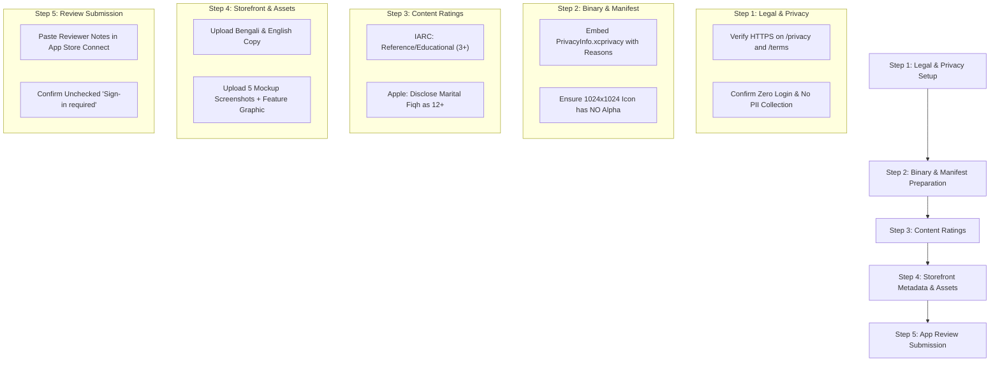

# App Store Release Package: Deen QnA (দ্বীন কিউএনএ)

**Release Manager Documentation & Submission Blueprint**  
**Version:** 1.0.0  
**Target Platforms:** Apple App Store (iOS, iPadOS) & Google Play Store (Android)  
**Host Application:** `https://deenqna.vercel.app`  
**Contact Email:** `support@deenqna.org`

---

## 1. Documentation Index

This directory contains the complete operational, legal, editorial, and asset package required to navigate Apple App Store and Google Play Console reviews smoothly:

| Document | Purpose & Key Contents | Primary Target |
| :--- | :--- | :--- |
| [**01_privacy_and_data_safety.md**](file:///Users/niyamulhasan/Desktop/Code/Question%20&%20Answer/docs/store/01_privacy_and_data_safety.md) | Hosted Privacy & Terms URLs, Data Collection Inventory (No accounts, crash logs & anonymous analytics only), Google Play Data Safety answers, Apple Nutrition Labels, and full `PrivacyInfo.xcprivacy` manifest with Required-Reason APIs. | Play Console & App Store Connect |
| [**02_content_ratings.md**](file:///Users/niyamulhasan/Desktop/Code/Question%20&%20Answer/docs/store/02_content_ratings.md) | Recommended answers for IARC (Google) and Apple Age Rating questionnaires. Strategic guidance on handling religious and matrimonial fiqh topics without triggering false flags. | Rating Boards (IARC & Apple) |
| [**03_review_risk_checklist.md**](file:///Users/niyamulhasan/Desktop/Code/Question%20&%20Answer/docs/store/03_review_risk_checklist.md) | Critical risk mitigation matrix: source attribution, copyright/fair-use statement, religious/medical/legal disclaimers, in-app report mechanism, working contact channels, and pre-submission audit checklist. | Risk & Compliance Officers |
| [**04_store_listing_copy.md**](file:///Users/niyamulhasan/Desktop/Code/Question%20&%20Answer/docs/store/04_store_listing_copy.md) | Bilingual store listing copy in **Bengali (বাংলা)** and **English**: App Name (<=30 chars), Subtitle (<=30 chars), Short Description (<=80 chars), Promotional Text, Full Descriptions, Apple Keywords (<=100 chars), What's New notes, and categories. | Store Front Metadata |
| [**05_assets_and_screenshots.md**](file:///Users/niyamulhasan/Desktop/Code/Question%20&%20Answer/docs/store/05_assets_and_screenshots.md) | Asset specifications: App icon (1024x1024 24-bit RGB with NO alpha for iOS), Android Adaptive Icon, Feature Graphic (1024x500), Screenshot resolutions (iPhone 6.9" & 6.5", iPad 13", Android Phone 16:9/9:16), 5-screen storyboard with bilingual headlines. | Creative & UI Teams |
| [**06_apple_reviewer_notes.md**](file:///Users/niyamulhasan/Desktop/Code/Question%20&%20Answer/docs/store/06_apple_reviewer_notes.md) | Complete copy-paste notes for the Apple App Review team: step-by-step app testing walkthrough, guest access declaration (no login needed), content provenance statement, and pre-formulated responses for review questions. | App Store Reviewers |

---

## 2. Release Manager Master Submission Roadmap

---

## 3. Key Takeaways for Successful Approval

1. **Guest Access (No Login Barrier):**  
   The application requires no authentication. Reviewers can test all search, filtering, and reading features instantly without demo credentials.

2. **Accurate Content Attribution (Guideline 5.2):**  
   Every fatwa is clearly attributed to its originating research journal (*Monthly At-Tahreek*, *Monthly Al-Kawsar*, *Al-I'tisam*), displays the answering scholar/mufti, provides a direct link to the original publication, and features a cryptographic SHA-256 integrity hash.

3. **Strict Disclaimers (Guideline 1.4.1 & 1.4):**  
   The app clearly informs users that it is an educational research archive and does not issue fatwas, provide medical advice, or offer legal counsel.

4. **Zero Alpha on iOS App Icon:**  
   The 1024x1024 PNG icon is strictly flattened 24-bit sRGB with zero transparency to prevent immediate rejection by Apple's asset validation pipeline.
